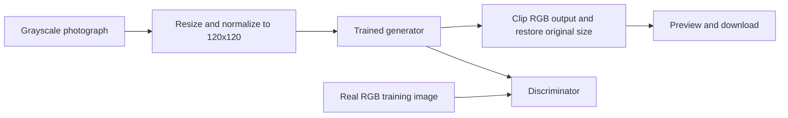

# ColorizeGAN: GAN-Based Image Colorization

[](https://github.com/kripashankarcs3/ColorizeGAN/actions/workflows/ci.yml)

> **Bringing Black-and-White Memories Back to Life.**

ColorizeGAN is a GAN-based image-colorization application designed to transform
grayscale photographs into visually rich color representations. By leveraging
Generative Adversarial Networks, the system learns image features and generates
plausible color distributions, helping bring historical photographs and old
memories back to life.

## Features

- Actual inference with the bundled `app/model/CCGAN_Model.h5` generator.
- PNG, JPG, and JPEG upload with validation and drag-and-drop support.
- Original and generated images shown side by side without aspect-ratio distortion.
- Background inference so the desktop interface remains responsive.
- Downloadable PNG output and two bundled sample photographs.
- A CLI entry point for scripted colorization.
- CPU-compatible TensorFlow configuration; CUDA is optional.

## Technology

Python, TensorFlow/Keras, PyQt5, Pillow, NumPy, scikit-learn, and Matplotlib.
The application is a desktop interface and does not require a web server.

## Architecture

The original repository's architecture is preserved. The generator accepts a
`120 x 120 x 1` grayscale image and produces a `120 x 120 x 3` RGB image. It
uses convolutional feature blocks, a `tanh` bottleneck, skip connections, and
transposed-convolution upsampling. The discriminator accepts `120 x 120 x 3`
RGB images, applies convolution and pooling blocks, and ends with dense layers
and a sigmoid real/fake prediction.

Training in `app/train.py` uses paired RGB images and grayscale conversions:

- generator loss: mean squared error between generated and real RGB images;
- discriminator loss: binary cross-entropy with small random label smoothing;
- optimizer: Adam with learning rate `0.0005` for both networks;
- default training configuration: batch size `5`, 200 epochs, 90/10 train/test split.

The saved generator is used for inference only. The discriminator is not needed
after training. No accuracy, PSNR, SSIM, or other performance metric is claimed.



## Project structure

```text
ColorizeGAN/
├── app/
│   ├── archs/                 # generator and discriminator definitions
│   ├── checkpoints/           # saved generator weights
│   ├── model/                # bundled generator model
│   ├── test/                 # bundled sample inputs
│   ├── colorize.py            # validated inference pipeline
│   ├── main_CLI_v1.py        # CLI entry point
│   ├── train.py              # original training loop
│   └── ui/                    # PyQt5 application and assets
├── tests/
├── download_dataset.py        # training image download
├── requirements.txt
├── requirements-train.txt     # extra training dependencies
├── setup.bat
└── run.bat
```

## Installation and execution on Windows

TensorFlow 2.15.1 is pinned because it supports the included Python 3.10/3.11
workflow. Python 3.11 is recommended.

```bat
setup.bat
run.bat
```

The desktop application opens directly. To use the CLI after setup:

```bat
.venv\Scripts\python.exe -m app.main_CLI_v1 app\test\building_GL.jpg
```

The generated file is written beside the source image as
`building_GL_colorized.png`, unless `--output` is supplied.

## Model availability

The repository includes both `app/model/CCGAN_Model.h5` and
`app/checkpoints/model_checkpoint.h5`. They are treated as inherited project
artifacts; this repository does not claim to have retrained or independently
created them. The application reports a clear setup error if the generator file
is missing. No training dataset is included in this checkout.

## Training

```bat
pip install -r requirements-train.txt
python download_dataset.py
python -m app.train
```

Images are downloaded to `dataset/train/color`, which `app/train.py` reads.

## Samples

The desktop gallery uses the included `app/test/Dog_GL.jpg` and
`app/test/building_GL.jpg` as real inference inputs.

## Limitations and future scope

This compact model was trained for fixed 120-pixel inputs, so fine detail and
unusual subjects may be colorized imperfectly. The output represents plausible
color, not historical truth. Future work could add richer datasets, perceptual
and adversarial generator losses, batch processing, interactive comparison
sliders, and an independently reproducible training/evaluation pipeline.

## Acknowledgements

Based on the [ReMemory AI](https://github.com/deepraj-07/ReMemory-AI) project,
which builds on [Color Craft GAN](https://github.com/Asirwad/Color-Craft-GAN).

## License

Released under the [MIT License](LICENSE).
